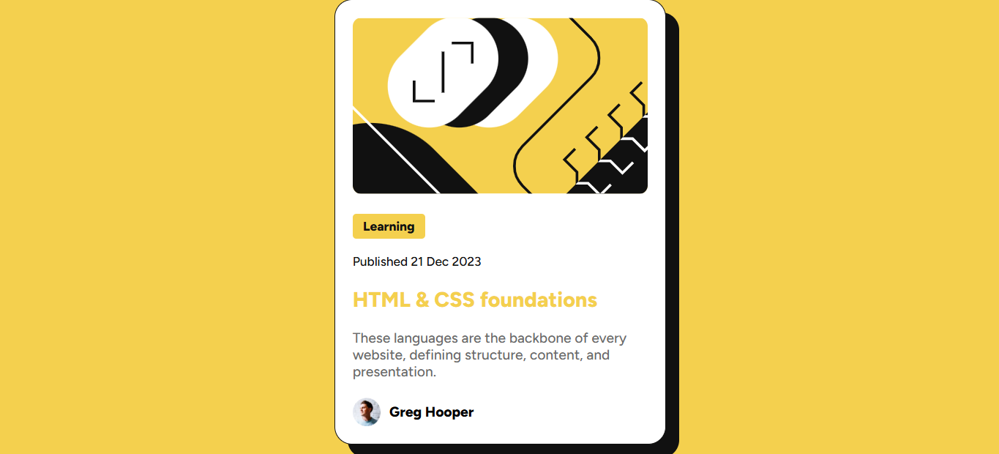

# Blog preview card webpage

## About the Project

This project is a simple and responsive blog preview card webpage created using HTML and CSS. It displays preview card for a blog containing an ilustration, date of publication, a title, a description, and the author of the blog.

## Screenshots

## Technologies Used

**HTML5:** Used to create the structure of the component.

**CSS3:** Used to style the component and improve its appearance.

**CSS Flexbox:** Used to style and design flexible and responsive layouts.

**CSS :Hover :** A CSS pseudo-class that matches an element when a user interacts with it, triggered when the user moves the cursor over an element without pressing the mouse button.

**Mobile Responsive Design:** Ensures the component looks good on different screen sizes, including mobile phones, tablets, and desktops.

## Features

- Clean and simple design.
- Proper alignment using Flexbox, Margin and Padding.
- Easy to understand and user-friendly interface.

## Author

Drony-92.
Created as a frontend development practice project.
